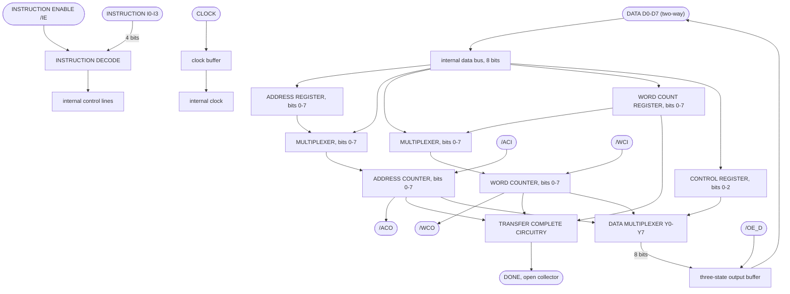
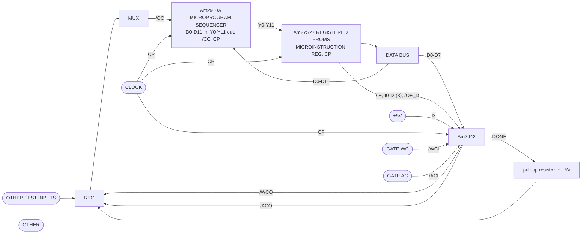
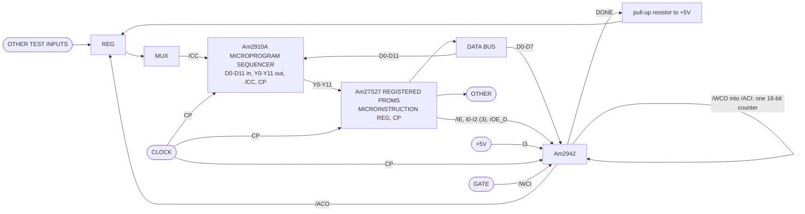

## Page 1

# Am2942

Programmable Timer/Counter DMA Address Generator

Am2942

## DISTINCTIVE CHARACTERISTICS

- **Expandable eight-bit slice**
  - Any number of Am2942s can be cascaded. Three devices provide a 48-bit counter.
- **Reinitialize capability**
  - Counters can be reinitialized from on-chip registers.
- **Executes 16 instructions**
  - Eight DMA instructions plus eight Timer/Counter instructions.
- **Programmable control modes**
  - Provide four types of control.
- **Two independent programmable 8-bit up/down counters**
  - Counters can be cascaded to form single-chip 16-bit up/down counter.
- **High speed bipolar LSI**
  - Typical count frequency of 25MHz and 24mA output current sink capability.

## GENERAL DESCRIPTION

The Am2942, a 22-pin version of the Am2940, can be used as a high-speed DMA Address Generator or Programmable Timer/Counter. It provides multiplexed Address and Data lines, for use with a common bus, and additional Instruction Input and Instruction Enable pins. The Am2942 executes 16 instructions; eight are the same as the Am2940 instructions, and eight instructions facilitate the use of the Am2942 as a Programmable Timer/Counter. The Instruction Enable input allows the sharing of the Am2942 instruction field with other devices.

When used as a Timer/Counter, the Am2942 provides two independent, programmable, eight-bit, up-down counters in a 22-pin package. The two on-chip counters can be cascaded to form a single chip, 16-bit counter. Also, any number of chips can be cascaded — for example three cascaded Am2942s form a 48-bit timer/counter.

Reinitialization instructions provide the capability to reinitialize the counters from on-chip registers. Am2942 Programmable Control Modes, identical to those of the Am2940, offer four different types of programmable control.

## BLOCK DIAGRAM



For applications information see the last part of this data sheet and Chapter VII of *Bit Slice Microprocessor Design*, by Mick and Brick, McGraw-Hill Publishers.

BD002520

03574B

5-279

Refer to Page 13-1 for Essential Information on Military Devices

---

## Page 2

# CONNECTION DIAGRAM

## Top View

### D-22  
### F-22*

```text
                    .-------------------.
          WCI   1 --|                   |-- 22  VCC
          WCO   2 --|                   |-- 21  DONE
          ACI   3 --|                   |-- 20  ACO
           D0   4 --|                   |-- 19  D7
           D1   5 --|      Am2942       |-- 18  D6
           D2   6 --|                   |-- 17  D5
           D3   7 --|                   |-- 16  D4
           IE   8 --|                   |-- 15  I3
          OED   9 --|                   |-- 14  I2
           CP  10 --|                   |-- 13  I1
          GND  11 --|___________________|-- 12  I0
```

CD004751

### Chip-Pak™  
### L-28

```text
Chip-Pak L-28, top view (pad number: signal)

  top     :  4 NC    3 /ACI   2 /WCO   1 /WCI   28 VCC   27 DONE   26 /ACO
  left    :  5 NC    6 D0     7 D1     8 D2     9 D3     10 /IE    11 NC
  right   : 25 NC   24 D7    23 D6    22 D5    21 D4     20 I3     19 I2
  bottom  : 12 /OED 13 CP    14 GND   15 NC    16 I0     17 I1     18 NC
```

CD004851

\*F-22 Pin Configuration identical to D-22

Note: Pin 1 is marked for orientation

# LOGIC SYMBOL

```text
                              20
                              |
                         ACO  |
                              |
                 .-----------------------.
              8 o| IE                    |---- 19  D7
             15 -| I3                    |---- 18  D6
             14 -| I2                    |---- 17  D5
             13 -| I1       Am2942       |---- 16  D4
             12 -| I0                    |----  7  D3
                 |         INSTRUCTION   |----  6  D2
             10 -| CP                    |----  5  D1
                 |                       |----  4  D0
                 |                       |----  9  OED
                 |                       |---- 21  DONE
                 '-----------------------'
                         |           |
                         |           |
                       ACI 3       WCI 1

                              2
                              |
                             WCO
```

LS000941

# METALLIZATION AND PAD LAYOUT

[Complex die metallization and pad layout drawing, with perimeter pad labels.]

DIE SIZE: 0.181" x 0.178"

# ORDERING INFORMATION

AMD products are available in several packages and operating ranges. The order number is formed by a combination of the following:  
Device number, speed option (if applicable), package type, operating range and screening option (if desired).

```text
Am2942       D       C       B
  |          |       |       |
  |          |       |       `-- Screening Option
  |          |       |           Blank - Standard processing
  |          |       |           B - Burn-in
  |          |       |
  |          |       `---------- Temperature (See Operating Range)
  |          |                    C - Commercial (0°C to +70°C)
  |          |                    M - Military (-55°C to +125°C)
  |          |
  |          `------------------ Package
  |                               D - 22-pin CERDIP
  |                               F - 22-pin flatpak
  |                               L - 28-pin leadless chip carrier
  |                               X - Die
  |
  `----------------------------- Device type
                                  DMA Address Generator
```

|  | Valid Combinations |
|---|---|
| Am2942 | DC, DCB, DMB<br>FMB<br>LC, LMB<br>XC, XM |

**Valid Combinations**  
Consult the AMD sales office in your area to determine if a device is currently available in the combination you wish.

Chip-Pak is a trademark of Advanced Micro Devices, Inc.

5-280

03574B

Refer to Page 13-1 for Essential Information on Military Devices

---

## Page 3

# PIN DESCRIPTION

| Pin No. | Name | I/O | Description |
|---|---|---|---|
| 12, 13, 14, 15 | I<sub>0-3</sub> | I | Selects one of sixteen instructions. |
| 3 | $\overline{\mathrm{ACI}}$ | I | Carry-in to the address counter. |
| 20 | $\overline{\mathrm{ACO}}$ | O | Carry-out from the address counter. |
| 1 | $\overline{\mathrm{WCI}}$ | I | Carry-in to the word counter. |
| 2 | $\overline{\mathrm{WCO}}$ | O | Carry-out from the word counter. |
|  | D<sub>0-7</sub> | I/O | Bidirectional data bus. |
| 9 | $\overline{\mathrm{OE_D}}$ | I | Data bus output enable. |
| 8 | $\overline{\mathrm{IE}}$ | I | Instruction enable for I<sub>0-2</sub>. |
| 21 | DONE | O | Transfer complete signal. |
| 10 | CP | I | Clock input. Registers and counters change on the LOW-to-HIGH transition. |

# Am2942 ARCHITECTURE

As shown in the Block Diagram, the Am2942 consists of the following:

- A three-bit Control Register.
- An eight-bit Address Counter with input multiplexer.
- An eight-bit Address Register.
- An eight-bit Word Counter with input multiplexer.
- An eight-bit Word Count Register.
- Transfer complete circuitry.
- An eight-bit wide data multiplexer with three-state output buffers.
- An instruction decoder.

## CONTROL REGISTER

Under instruction control, the Control Register can be loaded or read from the bidirectional DATA lines D<sub>0</sub>-D<sub>7</sub>. Control Register bits 0 and 1 determine the Am2942 Control Mode, and bit 2 determines whether the Address Counter increments or decrements. Figure 1 defines the Control Register format.

## Address Counter

The Address Counter, which provides the current memory address, is an eight-bit, binary, up/down counter with full lookahead carry generation. The Address Carry input ($\overline{\mathrm{ACI}}$) and Address Carry Output ($\overline{\mathrm{ACO}}$) allow cascading to accommodate larger addresses. Under instruction control, the Address Counter can be enabled, disabled, and loaded from the DATA inputs, D<sub>0</sub>-D<sub>7</sub>, or the Address Register. When enabled and the $\overline{\mathrm{ACI}}$ input is LOW, the Address Counter increments/decrements on the LOW-to-HIGH transition of the CLOCK input, CP.

## Address Register

The eight-bit Address Register saves the initial address so that it can be restored later in order to repeat a transfer operation. When the LOAD ADDRESS instruction is executed, the Address Register and Address Counter are simultaneously loaded from the DATA inputs, D<sub>0</sub>-D<sub>7</sub>.

## Word Counter and Word Count Register

The Word Counter and Word Count Register, which maintain and save a word count, are similar in structure and operation to the Address Counter and Address Register, with the exception that the Word Counter increments in Control Modes 1 and 3, decrements in Control Mode 0 and is disabled in Control Mode 2. The LOAD WORD COUNT instruction simultaneously loads the Word Counter and Word Count Register.

## Transfer Complete Circuitry

The Transfer Complete Circuitry is a combinational logic network which detects the completion of the data transfer operation in three Control Modes and generates the DONE output signal. The DONE signal is a open-collector output, which can be dot-anded between chips.

## Data Multiplexer

The Data Multiplexer is an eight-bit wide, three-input multiplexer which allows the Address Counter, Word Counter and Control Register to be read at DATA lines D<sub>0</sub>-D<sub>7</sub>. The Data Multiplexer output, Y<sub>0</sub>-Y<sub>7</sub>, is enabled onto DATA lines D<sub>0</sub>-D<sub>7</sub> if and only if the Output Enable input, $\overline{\mathrm{OE_D}}$, is LOW. (Refer to Figure 2.)

## Instruction Decoder

The Instruction Decoder generates required internal control signals as a function of the INSTRUCTION inputs, I<sub>0</sub>-I<sub>3</sub>, Control Register bits, CR<sub>0</sub>-CR<sub>1</sub>, and the INSTRUCTION ENABLE input, $\overline{\mathrm{IE}}$.

## Clock

The CLOCK input, CP is used to clock the Address Register, Address Counter, Word Count Register, Word Counter, and Control Register, all on the LOW-to-HIGH transition of the CP signal.

Am2942

5

5-281

03574B

Refer to Page 13-1 for Essential Information on Military Devices

---

## Page 4

# Am2942

## Control Register

| CR₂ | CR₁ | CR₀ |
|---|---|---|

| CR₁ | CR₀ | Control Mode Number | Control Mode Type | Word Counter | DONE Output Signal: WCI̅ = LOW | DONE Output Signal: WCI̅ = HIGH |
|---|---|---:|---|---|---|---|
| L | L | 0 | Word Count Equals Zero | Decrement | HIGH when Word Counter = 1 | HIGH when Word Counter = 0 |
| L | H | 1 | Word Count Compare | Increment | HIGH when Word Counter + 1 = Word Count Reg. | HIGH when Word Counter = Word Count Reg. |
| H | L | 2 | Address Compare | Hold | HIGH when Word Counter = Address Counter | HIGH when Word Counter = Address Counter |
| H | H | 3 | Word Counter Carry Out | Increment | Always LOW | Always LOW |

| CR₂ | Address Counter |
|---|---|
| L | Increment |
| H | Decrement |

H = HIGH  
L = LOW

**Figure 1. Control Register Format Definition.**

| OE̅ | D₀–D₇ |
|---|---|
| L | DATA MULTIPLEXER OUTPUT, Y₀–Y₇ |
| H | HIGH Z |

**Figure 2. Data Bus Output Enable Function.**

# Am2942 CONTROL MODES

## Control Mode 0 - Word Count Equals Zero Mode

In this mode, the LOAD WORD COUNT instruction loads the word count into the Word Count Register and Word Counter. When the Word Counter is enabled and the Word Counter Carry-in, WCI̅, is LOW, the Word Counter decrements on the LOW-to-HIGH transition of the CLOCK input, CP. Figure 1 specifies when the DONE signal is generated in this mode.

## Control Mode 1 - Word Count Compare Mode

In this mode the LOAD WORD COUNT instruction loads the word count into the Word Count Register and clears the Word Counter. When the Word Counter is enabled and the Word Counter Carry-in, WCI̅, is LOW, the Word Counter increments on the LOW-to-HIGH transition of the clock input, CP. Figure 1 specifies when the DONE signal is generated.

## Control Mode 2 - Address Compare Mode

In this mode, only an initial and final memory address need to be specified. The initial Memory Address is loaded into the Address Register and Address Counter and the final memory address is loaded into the Word Count Register and Word Counter. The Word Counter is always disabled in this mode and serves as a holding register for the final memory address.

When the Address Counter is enabled and the ACI̅ input is LOW, the Address Counter increments or decrements (depending on Control Register bit 2) on the LOW-to-HIGH transition of the CLOCK input, CP. The Transfer Complete Circuitry compares the Address Counter with the Word Counter and generates the DONE signal during the last word transfer; i.e., when the Address Counter equals the Word Counter.

## Control Mode 3 - Word Counter Carry Out Mode

For this mode of operation, the user can load the Word Count Register and Word Counter with the two's complement of the number of data words to be transferred. When the Word Counter is enabled and the WCI̅ input is LOW, the Word Counter increments on the LOW-to-HIGH transition of the CLOCK input, CP. A Word Counter Carry Out signal, WCO̅, indicates the last data word is being transferred. The DONE signal is not required in this mode and, therefore, is always LOW.

# Am2942 INSTRUCTIONS

The Am2942 instruction set consists of sixteen instructions. Eight are DMA Instructions and are similar to the Am2940 instructions. The remaining eight instructions are designed to facilitate the use of the Am2942 as a Programmable Timer/Counter. Figures 3 and 4 define the Am2942 Instructions.

5-282

03574B

Refer to Page 13-1 for Essential Information on Military Devices

---

## Page 5

Am2942

Instructions 0-7 are DMA instructions. The WRITE CONTROL REGISTER instruction writes DATA input D<sub>0</sub>-D<sub>2</sub> into the Control Register; DATA inputs D<sub>3</sub>-D<sub>7</sub> are "don't care" inputs for this instruction. The READ CONTROL REGISTER instruction gates the Control Register to Data Multiplexer outputs Y<sub>0</sub>-Y<sub>2</sub>. Outputs Y<sub>3</sub>-Y<sub>7</sub> are HIGH during this instruction.

The Word Counter can be read using the READ WORD COUNTER instruction, which gates the Word Counter to Data Multiplexer outputs, Y<sub>0</sub>-Y<sub>7</sub>. The LOAD WORD COUNT instruction is Control Mode dependent. In Control Modes 0, 2, and 3, DATA inputs D<sub>0</sub>-D<sub>7</sub> are written into both the Word Count Register and Word Counter. In Control Mode 1, DATA inputs D<sub>0</sub>-D<sub>7</sub> are written into the Word Count Register and the Word Counter is cleared.

The READ ADDRESS COUNTER instruction gates the Address Counter to Data Multiplexer outputs, Y<sub>0</sub>-Y<sub>7</sub>, and the LOAD ADDRESS instruction writes DATA inputs D<sub>0</sub>-D<sub>7</sub> into both the Address Register and Address Counter.

In Control Modes 0, 1, and 3, the ENABLE COUNTERS instruction enables both the Address and Word Counters; in Control Mode 2, the Address Counter is enabled and the Word Counter holds its contents. When enabled and the carry input is active, the counters increment on the LOW-to-HIGH transition of the CLOCK input, CP. Thus, with this instruction applied, counting can be controlled by the carry inputs.

The REINITIALIZE COUNTERS instruction also is Control Mode dependent. In Control Modes 0, 2, and 3, the contents of the Address Register and Word Count Register are transferred to the respective Address Counter and Word Counter; in Control Mode 1, the content of the Address Register is transferred to the Address Counter and the Word Counter is cleared. The REINITIALIZE COUNTERS instruction allows a data transfer operation to be repeated without reloading the address and word count from the DATA lines.

When E̅ is HIGH, Instruction inputs, I<sub>0</sub>-I<sub>2</sub>, are disabled. When I<sub>3</sub> is LOW, the function performed is identical to that of the ENABLE COUNTERS instruction. Thus, counting can be controlled by the carry inputs with the ENABLE COUNTERS instruction applied or with Instruction Inputs I<sub>0</sub>-I<sub>2</sub> disabled.

Instructions 8-F facilitate the use of the Am2942 as a Programmable Timer/Counter. They differ from instructions 0-7 in that they provide independent control of the Address Counter, Word Counter and Control Register.

The WRITE CONTROL REGISTER, T/C instruction writes DATA input D<sub>0</sub>-D<sub>2</sub> into the Control Register. DATA inputs D<sub>3</sub>-D<sub>7</sub> are "don't care" inputs for this instruction. The Address and Word Counters are enabled, and the Control Register contents appear at the Data Multiplexer output.

The REINITIALIZE ADDRESS COUNTER instruction allows the independent reinitialization of the Address Counter. The Word Counter is enabled and the contents of the Address Counter appear at the Data Multiplexer output.

The Word Counter can be read, using the READ WORD COUNTER, T/C instruction. Both counters are enabled when this instruction is executed.

When the READ ADDRESS COUNTER, T/C instruction is executed, both counters are enabled and the address counter contents appear at the Data Multiplexer output.

The REINITIALIZE ADDRESS and WORD COUNTERS instruction is identical to the REINITIALIZE COUNTERS instruction and provides the capability to reinitialize both counters at the same time. The Address Counter contents appear at the Data Multiplexer output.

DATA inputs D<sub>0</sub>-D<sub>7</sub> are loaded into both the Address Register and Counter when the LOAD ADDRESS, T/C instruction is executed. The Word Counter is enabled and its contents appear at the Data Multiplexer output.

The LOAD WORD COUNT, T/C instruction is identical to the LOAD WORD COUNT instruction with the exception that the Address Counter is enabled.

The Word Counter can be independently reinitialized using the REINITIALIZE WORD COUNTER instruction. The Address Counter is enabled and the Word Counter contents appear at the Data Multiplexer output.

When the E̅ input is HIGH, Instruction inputs, I<sub>0</sub>-I<sub>2</sub>, are disabled. The function performed when I<sub>3</sub> is HIGH is identical to that performed when I<sub>3</sub> is LOW, with the exception that the Word Counter contents appear at the Data Multiplexer output.

| E̅ | I<sub>3</sub> | I<sub>2</sub> | I<sub>1</sub> | I<sub>0</sub> | HEX CODE | Instruction | Type |
|---:|---:|---:|---:|---:|:---:|---|---|
| 0 | 0 | 0 | 0 | 0 | 0 | WRITE CONTROL REGISTER | DMA INSTRUCTIONS |
| 0 | 0 | 0 | 0 | 1 | 1 | READ CONTROL REGISTER | DMA INSTRUCTIONS |
| 0 | 0 | 0 | 1 | 0 | 2 | READ WORD COUNTER | DMA INSTRUCTIONS |
| 0 | 0 | 0 | 1 | 1 | 3 | READ ADDRESS COUNTER | DMA INSTRUCTIONS |
| 0 | 0 | 1 | 0 | 0 | 4 | REINITIALIZE COUNTERS | DMA INSTRUCTIONS |
| 0 | 0 | 1 | 0 | 1 | 5 | LOAD ADDRESS | DMA INSTRUCTIONS |
| 0 | 0 | 1 | 1 | 0 | 6 | LOAD WORD COUNT | DMA INSTRUCTIONS |
| 0 | 0 | 1 | 1 | 1 | 7 | ENABLE COUNTERS | DMA INSTRUCTIONS |
| 1 | 0 | X | X | X | 0-7 | INSTRUCTION DISABLE | DMA INSTRUCTIONS |
| 0 | 1 | 0 | 0 | 0 | 8 | WRITE CONTROL REGISTER, T/C | TIMER/COUNTER INSTRUCTIONS |
| 0 | 1 | 0 | 0 | 1 | 9 | REINITIALIZE ADDRESS COUNTER | TIMER/COUNTER INSTRUCTIONS |
| 0 | 1 | 0 | 1 | 0 | A | READ WORD COUNTER, T/C | TIMER/COUNTER INSTRUCTIONS |
| 0 | 1 | 0 | 1 | 1 | B | READ ADDRESS COUNTER, T/C | TIMER/COUNTER INSTRUCTIONS |
| 0 | 1 | 1 | 0 | 0 | C | REINITIALIZE ADDRESS & WORD COUNTERS | TIMER/COUNTER INSTRUCTIONS |
| 0 | 1 | 1 | 0 | 1 | D | LOAD ADDRESS, T/C | TIMER/COUNTER INSTRUCTIONS |
| 0 | 1 | 1 | 1 | 0 | E | LOAD WORD COUNT, T/C | TIMER/COUNTER INSTRUCTIONS |
| 0 | 1 | 1 | 1 | 1 | F | REINITIALIZE WORD COUNTER | TIMER/COUNTER INSTRUCTIONS |
| 1 | 1 | X | X | X | 8-F | INSTRUCTION DISABLE, T/C | TIMER/COUNTER INSTRUCTIONS |

0 = LOW   1 = HIGH   X = DON'T CARE

Notes:

1. When I<sub>3</sub> is tied LOW, the Am2942 acts as a DMA circuit. When I<sub>3</sub> is tied HIGH, the Am2942 acts as a Timer/Counter circuit.
2. Am2942 instructions 0 through 7 are the same as Am2940 instructions.

## Figure 3. Am2942 Instructions.

5-283

03574B

Refer to Page 13-1 for Essential Information on Military Devices

---

## Page 6

# Am2942

| \(\overline{IE}\) | I₃I₂I₁I₀ (Hex) | Function | Mnemonic | Control Mode | Word Reg. | Word Counter | Adr. Reg. | Adr. Counter | Control Reg. | Data Multiplexer Output |
|---|---:|---|---|---|---|---|---|---|---|---|
| L | 0 | WRITE CONTROL REGISTER | WRCR | 0, 1, 2, 3 | HOLD | HOLD | HOLD | HOLD | D₀-₂ → CR | FORCED HIGH |
| L | 1 | READ CONTROL REGISTER | RDCR | 0, 1, 2, 3 | HOLD | HOLD | HOLD | HOLD | HOLD | CONTROL REG. |
| L | 2 | READ WORD COUNTER | RDWC | 0, 1, 2, 3 | HOLD | HOLD | HOLD | HOLD | HOLD | WORD COUNTER |
| L | 3 | READ ADDRESS COUNTER | RDAC | 0, 1, 2, 3 | HOLD | HOLD | HOLD | HOLD | HOLD | ADR. COUNTER |
| L | 4 | REINITIALIZE COUNTERS | REIN | 0, 2, 3 | HOLD | WR → WC | HOLD | AR → AC | HOLD | ADR. CNTR. |
|  |  |  |  | 1 | HOLD | ZERO → WC | HOLD | AR → AC | HOLD | ADR. CNTR. |
| L | 5 | LOAD COUNT (printed so in the original; Figure 3 names code 5 LOAD ADDRESS) | LDAD | 0, 1, 2, 3 | HOLD | HOLD | D → AR | D → AC | HOLD | WORD COUNTER |
| L | 6 | LOAD WORD COUNT | LDWC | 0, 2, 3 | D → WR | D → WC | HOLD | HOLD | HOLD | FORCED HIGH |
|  |  |  |  | 1 | D → WR | ZERO → WC | HOLD | HOLD | HOLD | FORCED HIGH |
| L | 7 | ENABLE COUNTERS | ENCT | 0, 1, 3 | HOLD | ENABLE | HOLD | ENABLE | HOLD | ADR. CNTR |
|  |  |  |  | 2 | HOLD | HOLD | HOLD | ENABLE | HOLD | ADR. CNTR. |
| H | 0-7 | INSTRUCTION DISABLE | - | 0, 1, 3 | HOLD | ENABLE | HOLD | ENABLE | HOLD | ADR. CNTR. |
|  |  |  |  | 2 | HOLD | HOLD | HOLD | ENABLE | HOLD | ADR. CNTR. |
| L | 8 | WRITE CONTROL REGISTER, T/C | WCRT | 0, 1, 2, 3 | HOLD | ENABLE | HOLD | ENABLE | D₀-₂ → CR | CONTROL REG. |
| L | 9 | REINITIALIZE ADR. COUNTER | REAC | 0, 1, 2, 3 | HOLD | ENABLE | HOLD | AR → AC | HOLD | ADR. COUNTER |
| L | A | READ WORD COUNTER, T/C | RWCT | 0, 1, 2, 3 | HOLD | ENABLE | HOLD | ENABLE | HOLD | WORD COUNTER |
| L | B | READ ADDRESS COUNTER, T/C | RACT | 0, 1, 2, 3 | HOLD | ENABLE | HOLD | ENABLE | HOLD | ADR. COUNTER |
| L | C | REINITIALIZE ADDRESS AND WORD COUNTERS | RAWC | 0, 2, 3 | HOLD | WR → WC | HOLD | AR → AC | HOLD | ADR. CNTR. |
|  |  |  |  | 1 | HOLD | ZERO → WC | HOLD | AR → AC | HOLD | ADR. CNTR. |
| L | D | LOAD ADDRESS, T/C | LDAT | 0, 1, 2, 3 | HOLD | ENABLE | D → AR | D → AC | HOLD | WORD COUNTER |
| L | E | LOAD WORD COUNT, T/C | LWCT | 0, 2, 3 | D → WR | D → WC | HOLD | ENABLE | HOLD | FORCED HIGH |
|  |  |  |  | 1 | D → WR | ZERO → WC | HOLD | ENABLE | HOLD | FORCED HIGH |
| L | F | REINITIALIZE WORD COUNTER | REWC | 0, 2, 3 | HOLD | WR → WC | HOLD | ENABLE | HOLD | WD. CNTR. |
|  |  |  |  | 1 | HOLD | ZERO → WC | HOLD | ENABLE | HOLD | WD. CNTR. |
| H | 8-F | INSTRUCTION DISABLE, T/C | - | 0, 1, 3 | HOLD | ENABLE | HOLD | ENABLE | HOLD | WD. CNTR. |
|  |  |  |  | 2 | HOLD | HOLD | HOLD | ENABLE | HOLD | WD. CNTR. |

WR = WORD REGISTER  
WC = WORD COUNTER  
AR = ADDRESS REGISTER  

AC = ADDRESS COUNTER  
CR = CONTROL REGISTER  
D = DATA  

**Figure 4. Am2942 Function Table.**

# APPLICATIONS

Figure 5 shows an Am2942 used as two independent, programmable eight-bit timer/counters. In this example, an Am2910A Microprogram Sequencer provides an address to Am27S27 512 x 8 Registered PROMs. The on-chip PROM output register is used as the Microinstruction Register.

The Am2942 Instruction input, I₃, is tied HIGH to select the eight Timer/Counter instructions. The \(\overline{IE}\), I₀-I₂, and \(\overline{OED}\) inputs are provided by the microinstruction, and the D₀-D₇ data lines are connected to a common Data Bus. GATE WC and GATE AC are separate enable controls for the respective Word Counter and Address Counter. The DONE, \(\overline{ACO}\) and \(\overline{WCO}\) output signals indicate that a pre-programmed time or count has been reached.

Figure 6 shows an Am2942 used as a single 16-bit programmable timer/counter. In this example, the Word Counter carry-out, WCO, is connected to the Address Counter carry-in, ACI, to form a single 16-bit counter which is enabled by the GATE signal.

Figure 7 shows two Am2942s cascaded to form a 32-bit programmable timer/counter. The two Word Counters form the low order 16 bits, and the two Address Counters form the high order bits. This allows the timer/counter to be loaded and read 16 bits at a time.

5-284

03574B

Refer to Page 13-1 for Essential Information on Military Devices

---

## Page 7

# Am2942



**Figure 5. Two 8-Bit Programmable Counters/Timers in a 22-Pin Package.**

AF001911



**Figure 6. 16-Bit Programmable Counter/Timer Using a Single Am2942.**

AF001901

03574B

5-285

Refer to Page 13-1 for Essential Information on Military Devices

---

## Page 8

# Figure 7. 32-Bit Programmable Counter/Timer Using Two Am2942s.

```text
                                                                                         Am2942


               OTHER
               TEST
               INPUTS
                 │
                 ├───────────────┐
                 ├───────────────┤     ┌───────────┐     ┌───────────┐
                 ├───────────────┤────►│           │────►│           │
                 ├───────────────┤     │    REG    │     │    MUX    │
                 ├───────────────┤────►│           │────►│           │
                 ├───────────────┤     │           │     │           │
                 └───────────────┘     └───────────┘     └─────┬─────┘
                                                                 │
                                                                 │
                                           ┌─────────────────────┴──────────────────────────────┐
                                           │                         CC                          │
                                  ┌────────┴───────────────────────────────────────────────┐     │
                                  │                    Am2910A                              │◄────┘
                                  │              MICROPROGRAM SEQUENCER                      │
                                  │                                                          │
                                  │                         CP                               │
                                  │                       Y0-Y11                             │
                                  └─────────────────────────┬────────────────────────────────┘
                                                            │
                                                            ▼
                                  ┌──────────────────────────────────────────────────────────┐
                                  │                         Am27S27                          │
                                  │                   REGISTERED PROMS                        │
                                  ├──────────────────────────────────────────────────────────┤
                                  │                  MICROINSTRUCTION REG                 CP │
                                  └───────────┬───────────┬───────────┬───────────┬──────────┘
                                              │           │           │           │
                                      OTHER ──┘           │           │           │
                                                          │           │           │
                                                          │       DATA BUS (16)    │
                                                          │           │           │
                                      ┌───────────────────┴───┐   ┌───┴───────────────────┐
                                      │                       │   │                       │
                                      │        Am2942         │   │        Am2942         │
                                      │                       │   │                       │
                                      │ IE̅ I0-I2 I3 OE̅D D0-D7│   │ IE̅ I0-I2 I3 OE̅D D0-D7│
                                      │                       │   │                       │
                                      │ W̅C̅                    │   │ W̅C̅                    │
                                      │ A̅C̅                    │   │ A̅C̅                    │
                                      │                       │   │                       │
                                      │         DONE          │   │         DONE          │
                                      └───────────┬───────────┘   └───────────┬───────────┘
                                                  │                           │
                                                  └───────────────┬───────────┘
                                                                  │
                                                              /\/\/\  +5V


                    +5V                                      (8-15)                   +5V
                     │                                                                  │
                     │                                                                  │
                     └──────────────────────────────────────────────────────────────────┐
                                                                                        │
                                                                                      (0-7)

                                                                  ────────────────────────►
                                                                                         GATE

                                                              ──────────────────────────►
                                                                                         CLOCK


                                                             AF001921
```

5-286                                      Refer to Page 13-1 for Essential Information on Military Devices

03574B

---

## Page 9

# ABSOLUTE MAXIMUM RATINGS

| Parameter | Rating |
|---|---:|
| Storage Temperature | −65°C to +150°C |
| (Ambient) Temperature Under Bias | −55°C to +125°C |
| Supply Voltage to Ground Potential—Continuous | −0.5V to +7.0V |
| DC Voltage Applied to Outputs For High Output State | −0.5V to +V<sub>CC</sub> max |
| DC Input Voltage | −0.5V to +5.5V |
| DC Output Current, Into Outputs | 30mA |
| DC Input Current | −30mA to +5.0mA |

*Stresses above those listed under ABSOLUTE MAXIMUM RATINGS may cause permanent device failure. Functionality at or above these limits is not implied. Exposure to absolute maximum ratings for extended periods may affect device reliability.*

# OPERATING RANGES

| Device | Parameter | Range |
|---|---|---:|
| Commercial (C) Devices | Temperature | 0°C to +70°C |
| Commercial (C) Devices | Supply Voltage | +4.75V to +5.25V |
| Military (M) Devices | Temperature | −55°C to +125°C |
| Military (M) Devices | Supply Voltage | +4.5V to +5.5V |

*Operating ranges define those limits over which the functionality of the device is guaranteed.*

Am2942

# DC CHARACTERISTICS

*over operating range unless otherwise specified*

| Parameters | Description | Test Conditions (Note 2) | Min | Typ (Note 1) | Max | Units |
|---|---|---|---:|---:|---:|---|
| V<sub>OH</sub> | Output HIGH Voltage | V<sub>CC</sub> = MIN, V<sub>IN</sub> = V<sub>IH</sub> or V<sub>IL</sub>; MIL I<sub>OH</sub> = −1.0mA; COM'L I<sub>OH</sub> = −2.6mA | 2.4 |  |  | Volts |
| V<sub>OL</sub> | Output LOW Voltage | V<sub>CC</sub> = MIN, V<sub>IN</sub> = V<sub>IH</sub> or V<sub>IL</sub>; WCO, ACO: MIL I<sub>OL</sub> = 8.0mA, COM'L I<sub>OL</sub> = 12mA; D<sub>0-7</sub>, DONE: MIL I<sub>OL</sub> = 16mA, COM'L I<sub>OL</sub> = 24mA |  |  | 0.5 | Volts |
| V<sub>IH</sub> | Input HIGH Level (Note 4) | Guaranteed input Logical HIGH voltage for all inputs | 2.0 |  |  | Volts |
| V<sub>IL</sub> | Input LOW Level (Note 4) | Guaranteed input Logical LOW voltage for all inputs |  |  | 0.8 | Volts |
| V<sub>I</sub> | Input Clamp Voltage | V<sub>CC</sub> = MIN, I<sub>IN</sub> = −18mA |  |  | −1.5 | Volts |
| I<sub>IL</sub> | Input LOW Current | V<sub>CC</sub> = MAX, V<sub>IN</sub> = 0.5V; D<sub>0-7</sub> |  |  | −0.15 | mA |
| I<sub>IL</sub> | Input LOW Current | V<sub>CC</sub> = MAX, V<sub>IN</sub> = 0.5V; All Others |  |  | −0.8 | mA |
| I<sub>IH</sub> | Input HIGH Current | V<sub>CC</sub> = MAX, V<sub>IN</sub> = 2.7V; D<sub>0-7</sub> |  |  | 150 | µA |
| I<sub>IH</sub> | Input HIGH Current | V<sub>CC</sub> = MAX, V<sub>IN</sub> = 2.7V; All Others |  |  | 40 | µA |
| I<sub>CEX</sub> | Output Leakage on DONE | V<sub>CC</sub> = MAX, V<sub>O</sub> = 5.5V |  |  | 250 | µA |
| I<sub>I</sub> | Input HIGH Current | V<sub>CC</sub> = MAX, V<sub>IN</sub> = 5.5V |  |  | 1.0 | mA |
| I<sub>SC</sub> | Output Short Circuit Current (Note 3) | V<sub>CC</sub> = MAX + 0.5V, V<sub>O</sub> = 0.5V | −30 |  | −85 | mA |
| I<sub>OZL</sub> | Output OFF Current | V<sub>CC</sub> = MAX; OE = 2.4V; V<sub>OUT</sub> = 0.5V; D<sub>0-7</sub> |  |  | −150 | µA |
| I<sub>OZH</sub> | Output OFF Current | V<sub>CC</sub> = MAX; OE = 2.4V; V<sub>OUT</sub> = 2.4V; D<sub>0-7</sub> |  |  | 150 | µA |
| I<sub>CC</sub> | Power Supply Current | V<sub>CC</sub> = MAX; Am2942PC, DC; T<sub>A</sub> = 0°C to +70°C |  |  | 265 | mA |
| I<sub>CC</sub> | Power Supply Current | V<sub>CC</sub> = MAX; Am2942PC, DC; T<sub>A</sub> = +70°C |  |  | 220 | mA |
| I<sub>CC</sub> | Power Supply Current | V<sub>CC</sub> = MAX; Am2942DM, FM; T<sub>C</sub> = −55°C to +125°C |  |  | 285 | mA |
| I<sub>CC</sub> | Power Supply Current | V<sub>CC</sub> = MAX; Am2942DM, FM; T<sub>C</sub> = +125°C |  |  | 205 | mA |

**Notes:**

1. Typical limits are at V<sub>CC</sub> = 5.0V, 25°C ambient and maximum loading.
2. For conditions shown as MIN or MAX, use the appropriate value specified under Operating Ranges for the applicable device type.
3. Not more than one output should be shorted at a time. Duration of the short circuit test should not exceed one second.
4. These input levels provide no guaranteed noise immunity and should only be static tested in a noise-free environment (not functionally tested).

5

03574B

5-287

Refer to Page 13-1 for Essential Information on Military Devices

---

## Page 10

# SWITCHING TEST CIRCUIT

## A. THREE STATE OUTPUTS

```text
                                      VCC
                                       o
                                       |
                                      o/ S2
                                       |
                                      R1
                                       |
VOUT o---o/ S1---+---+---|<|-----------+---|>|---|>|---|>|---+
                 |   |                                  |     |
                C_L  1K                                 |    o
                 |   |                                  |   o/ S3
                GND  +----------------------------------+    |
                                                         |   GND
                                                        [device]

                              TC001100
```

\[
R_1 =
\frac{5.0 - V_{BE} - V_{OL}}
{\dfrac{I_{OL} + V_{OL}}{1K}}
\]

## B. NORMAL OUTPUTS

```text
                                      VCC
                                       o
                                       |
                                      R1
                                       |
VOUT o---o/ S1---+---+---|<|-----------+---|>|---|>|---|>|---+
                 |   |                                      |
                R2  C_L                                    GND
                 |   |
                GND GND

                              TC001101
```

\[
R_2 = \frac{2.4V}{I_{OH}}
\]

\[
R_1 =
\frac{5.0 - V_{BE} - V_{OL}}
{\dfrac{I_{OL} + V_{OL}}{R_2}}
\]

## C. OPEN-COLLECTOR OUTPUTS

```text
                    VCC
                     o
                     |
                    R1
                     |
VOUT o---o/ S1-------+ 
                     |
                    C_L
                     |
                    GND

                    TC001220
```

\[
R_1 = \frac{5.0 - V_{OL}}{I_{OL}}
\]

Notes:

1. \(C_L = 50pF\) includes scope probe, wiring and stray capacitances without device in test fixture.
2. \(S_1\), \(S_2\), \(S_3\) are closed during function tests and all AC tests except output enable tests.
3. \(S_1\) and \(S_3\) are closed while \(S_2\) is open for \(t_{PZH}\) test.  
   \(S_1\) and \(S_2\) are closed while \(S_3\) is open for \(t_{PZL}\) test.
4. \(C_L = 5.0pF\) for output disable tests.

# TEST OUTPUT LOADS FOR Am2942 (DIP)

| Pin# (DIP) | Pin Label | Test Circuit | R₁ | R₂ |
|---|---|---:|---:|---:|
| — | D₀–₇ | A | 220 | 1K |
| 20 | \(\overline{ACO}\) | B | 470 | 2.4K |
| 21 | DONE | C | 270 | — |
| 2 | \(\overline{WCO}\) | B | 470 | 2.4K |

For additional information on testing, see section  
"Guidelines on Testing Am2900 Family Devices."

Am2942

5-288

03574B

Refer to Page 13-1 for Essential Information on Military Devices

---

## Page 11

# SWITCHING CHARACTERISTICS

The tables below define the Am2942 switching characteristics. Tables A are set-up and hold times relative to the clock LOW-to-HIGH transition. Tables B are combinational delays. Tables C are clock requirements. All measurements are made at 1.5V with input levels at 0V or 3V. All values are in ns with C<sub>L</sub> = 50pF except output disable times (I to D) which are specified for a 5pF load.

# I. GUARANTEED CHARACTERISTICS OVER COMMERCIAL OPERATING RANGE

## Am2942, DC (T<sub>A</sub> = 0 to +70°C, V<sub>CC</sub> = 4.75 to 5.25V, C<sub>L</sub> = 50pF)

### A. Set-up and Hold Times  
*(Relative to clock LOW-to-HIGH transition)*

| Input | t<sub>s</sub> | t<sub>h</sub> |
|---|---:|---:|
| D<sub>0-7</sub> | 24 | 6 |
| I<sub>0-3</sub> | 46 | 5 |
| $\overline{ACI}$ | 30 | 4 |
| $\overline{WCI}$ | 30 | 3 |
| I<sub>E</sub> | 46 | 5 |

### B. Combinational Delays

| Input | $\overline{ACO}$ | $\overline{WCO}$ | DONE | D<sub>0-7</sub> |
|---|---:|---:|---:|---:|
| $\overline{ACI}$ | 20 | - | - | - |
| $\overline{WCI}$<br>(Note 1) | - | 20 | 46 | - |
| I<sub>0-3</sub> | - | - | - | 37 |
| CP<br>(Note 2) | 58 | 58 | 85 | 59 |
| I<sub>E</sub> | - | - | - | 37 |

### C. Clock Requirements

|  |  |  |
|---|---:|---|
| Minimum Clock LOW Time | 23 | ns |
| Minimum Clock HIGH Time | 34 | ns |
| Maximum Clock Frequency | 17 | MHz |

### D. Enable/Disable Times

| From | To | Disable | Enable |  |
|---|---|---:|---:|---|
| $\overline{OE}$ | D<sub>0-7</sub> | 25 | 25 | ns |

# II. GUARANTEED CHARACTERISTICS OVER MILITARY OPERATING RANGE

## Am2942DM, FM (T<sub>C</sub> = −55 to +125°C, V<sub>CC</sub> = 4.5 to 5.5V, C<sub>L</sub> = 50pF)

### A. Set-up and Hold Times  
*(Relative to clock LOW-to-HIGH transition)*

| Input | t<sub>s</sub> | t<sub>h</sub> |
|---|---:|---:|
| D<sub>0-7</sub> | 27 | 7 |
| I<sub>0-3</sub> | 49 | 5 |
| $\overline{ACI}$ | 34 | 5 |
| $\overline{WCI}$ | 34 | 5 |
| I<sub>E</sub> | 49 | 5 |

### B. Combinational Delays

| Input | $\overline{ACO}$ | $\overline{WCO}$ | DONE | D<sub>0-7</sub> |
|---|---:|---:|---:|---:|
| $\overline{ACI}$ | 21 | - | - | - |
| $\overline{WCI}$<br>(Note 1) | - | 21 | 54 | - |
| I<sub>0-3</sub> | - | - | - | 41 |
| CP<br>(Note 2) | 64 | 64 | 88 | 68 |
| I<sub>E</sub> | - | - | - | 41 |

### C. Clock Requirements

|  |  |  |
|---|---:|---|
| Minimum Clock LOW Time | 23 | ns |
| Minimum Clock HIGH Time | 35 | ns |
| Maximum Clock Frequency | 17 | MHz |

### D. Enable/Disable Times

| From | To | Disable | Enable |  |
|---|---|---:|---:|---|
| $\overline{OE}$ | D<sub>0-7</sub> | 30 | 30 | ns |

Notes:  
1. $\overline{WCI}$ to DONE occurs only in control modes 0 and 1.  
2. CP to DONE occurs only in control modes 0, 1, and 2.

Am2942

5

5-289

03574B

Refer to Page 13-1 for Essential Information on Military Devices

---

## Page 12

Am2942

```text
                                      3.0V  _________________________________________________
                             INPUTS         \\\\\\\\\\\\\\\\\\                 \\\\\\\\\\
                                      0V  ___\\\\\\\\\\\\\\\\\\_______________\\\\\\\\\\\\___
                                                        |       1.5V           |  1.5V
                                                        |                       |
                                                        |<--------- tS -------->|
                                                        |                       |
                                      3.0V ___         ___________________        ___________
                             CLOCK         \__________/                   \______/           _
                                      0V                 1.5V        1.5V
                                                        |               |
                                                        |<-- CLOCK TO -->|
                                                        |   OUTPUT DELAY  |<-- INPUT TO
                                                        |                 |    OUTPUT DELAY
                                                        |        MINIMUM CLOCK
                                                        |          LOW TIME
                                      ________________________________
                            OUTPUTS   ____________\\\\\\\\\\\\\\\\\\__________________________
                                                    \\\\\\\\\\\\\\\\\\
                                                               |
                                                               tH

                                                                        WF003101
```

## Figure 8. Switching Waveforms.

See Tables A for t<sub>S</sub> and t<sub>H</sub> for various inputs. See Tables B for combinational delays from clock and other inputs to outputs.

# Notes on Testing

Incoming test procedures on this device should be carefully planned, taking into account the high complexity and power levels of the part. The following notes may be useful:

1. Insure the part is adequately decoupled at the test head. Large changes in V<sub>CC</sub> current when the device switches may cause erroneous function failures due to V<sub>CC</sub> changes.

2. Do not leave inputs floating during any tests, as they may start to oscillate at high frequency.

3. Do not attempt to perform threshold tests at high speed. Following an input transition, ground current may change by as much as 400mA in 5-8ns. Inductance in the ground cable may allow the ground pin at the device to rise by 100s of millivolts momentarily.

4. Use extreme care in defining input levels for AC tests. Many inputs may be changed at once, so there will be significant noise at the device pins and they may not actually reach V<sub>IL</sub> or V<sub>IH</sub> until the noise has settled. AMD recommends using V<sub>IL</sub> ≤ 0V and V<sub>IH</sub> ≥ 3.0V for AC tests.

5. To simplify failure analysis, programs should be designed to perform DC, Function and AC tests as three distinct groups of tests.

6. To assist in testing, AMD offers complete documentation on our test procedures and, in most cases, can provide Fairchild Sentry programs, under license.

5-290

03574B

Refer to Page 13-1 for Essential Information on Military Devices

---

